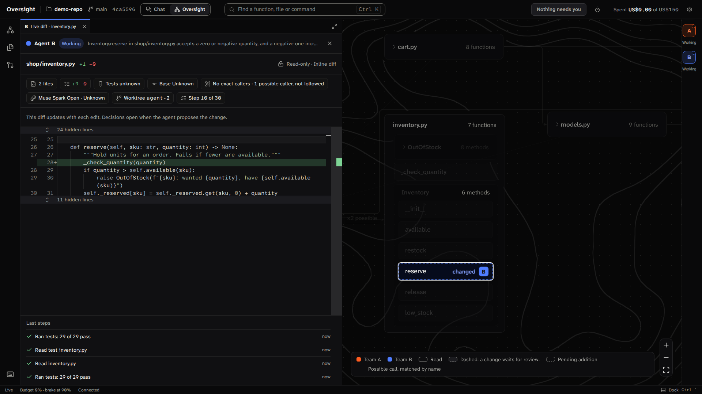
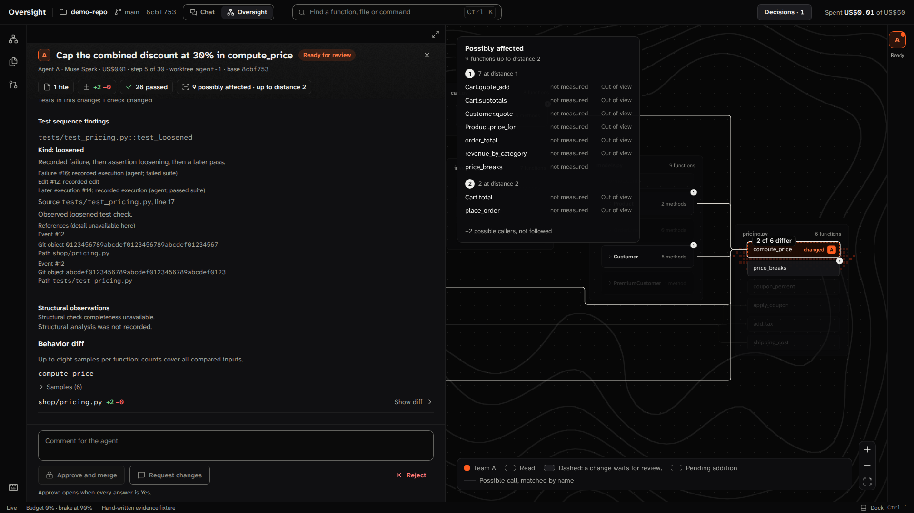
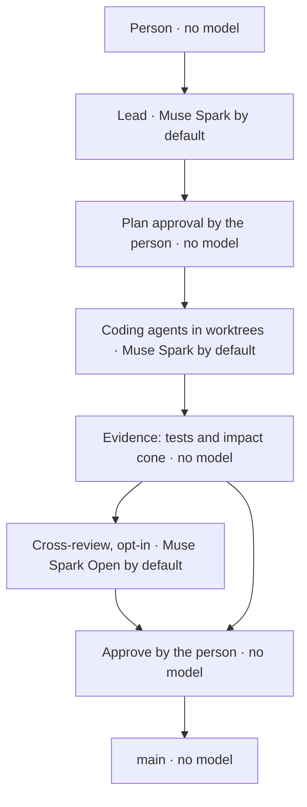

# Oversight

Agents write code faster than anyone can review it. Oversight is how you stop reading code without
losing control.

Try [Would you approve it?](https://matidegli.github.io/oversight/): a real recorded run in your browser, no install, works at phone width; choose “Two-change practice”.

Video: (link added at submission)

## What it is

Oversight is a web IDE for supervising coding agents on Python repositories. Chat opens first.
Chat with a lead that proposes plans for your approval, or start a coding task directly.
Coding agents work in separate git worktrees. Switch to Oversight to keep the repository graph
in view: reads and edits light up, and each change has a bounded impact cone of functions
possibly affected. Review shows the diff, event-derived facts, tests that fail before and pass
after where proved, and optional behavior comparisons and measured caller evidence.
Nothing reaches main without your approval or rules you explicitly set.
The lead composes constrained generative UI in Chat with `show_view`: closed reference kinds, values from committed events; built, not released.



Current UI replaying the real recorded run (`fixtures/events/recorded-demo.jsonl`; Oct 27, 2026); this edit has no exact callers.

## Features

“On” means available by default, not that a model runs without a request. Optional evidence needs
Linux isolation; rules also require an independent reviewer. Every run starts in **Ask me**.

| Feature | What it does | Meta models | Default |
| --- | --- | --- | --- |
| Lead Chat and plans | Discuss tasks; approve a proposed plan before the server queues its agents. | Muse Spark, Muse Spark Open | On |
| Constrained generative UI | Lead Chat composes closed highlight, changed-file, behavior and moment reference views from committed events through `show_view`, advertised and dispatched. Synthetic proofs exist; release awaits the paid probe, prompt validation and real recording. | Muse Spark, Muse Spark Open | Built, not released |
| Parallel coding agents | Four slots by default, up to six; each agent edits and tests in its own worktree with six fixed tools, plus read-only `find_symbol` while the harness is on (the default), and no shell. | Muse Spark, Muse Spark Open | On |
| Agent harness | Syntax checks, edit diagnostics, bounded search feedback, a test-before-finish guard and read-only Python symbol lookup (`find_symbol`); turn off with `OVERSIGHT_HARNESS_PACK=false`. | None | On |
| Repository graph and impact cone | See reads, edits, shared work and bounded possible effects, with module, function and detail views. | None | On |
| Diff and facts | Review the diff, an event-derived summary, tests and recorded steps. | None | On |
| Fails before, passes after | Check changed tests against both versions; missing evidence stays unknown. | None | On |
| Independent cross-review | Review with a different model profile and allow one automatic Request changes round. | Muse Spark, Muse Spark Open | Opt-in (`OVERSIGHT_CROSS_REVIEW`) |
| Behavior comparisons | Run old and new functions on the same bounded inputs; show differences and unprobed cases. | None | Opt-in (`OVERSIGHT_BEHAVIOR_DIFF`) |
| Difference questions | Classify measured differences as asked for, not asked for or unclear; requires a separate Baseten budget. | Muse Spark Open | Opt-in (`OVERSIGHT_BEHAVIOR_DIFF` or `OVERSIGHT_MEASURED_CONE`) |
| Measured callers | Compare caller results under tests, within the static impact cone. | None | Opt-in (`OVERSIGHT_MEASURED_CONE`) |
| Merge decisions and rules | Approve, reject or request changes; explicitly select guarded rules, standing grants and Revert. | None | On |
| Cost and usage | Track spend, unknown usage and archived totals; refuse new Meta runs above 90% of the budget. | None | On |
| Live demo preview | Open one agent's demo shop proposal at a time; reviewed-app execution remains unavailable. | None | Opt-in (`OVERSIGHT_PREVIEW_ENABLED`) |
| Replay and practice | Play the bundled real run without a backend and compare your decisions with the recorded ones. | None | On |
| Sources and platforms | Start with the demo; select prepared pinned profiles, including Oversight's reviewed copy, or validated native Windows copies. Linux/WSL is the verified path. | None | On |



Current UI with hand-written example data showing a test failure, an assertion edit and a later pass.

- The static replay build plays `fixtures/events/recorded-demo.jsonl` by default; its
  label comes from provenance: `Recorded run · Oct 27, 2026`.

## How Oversight uses Meta's models

**Muse Spark** uses the Meta Model API at `https://api.meta.ai/v1`, in Contributor mode (`muse-spark-1.3-contributor`). It is the default author, lead and standalone planner.
Coding slots can switch to Muse Spark Open with `OVERSIGHT_AGENT_MODEL` and per-slot
`OVERSIGHT_AGENT_MODEL_B` through `OVERSIGHT_AGENT_MODEL_F`; leads accept either model.

**Muse Spark Open** uses Baseten at `https://inference.baseten.co/v1`
(`meta-models/muse-spark-open-1026`). It is the default opt-in cross-reviewer and the only
behavior-decision model. `OVERSIGHT_REVIEW_MODEL` can select either model, but must differ from
the author. The split gives review a distinct profile and behavior classification a bounded choice.

Both use the official OpenAI SDK, with `low` reasoning set on every real call. The client retries
429 and 5xx with exponential backoff and jitter; missing token usage stays unknown. Meta's spending
brake refuses new runs above 90%. Replies become whole-message events, never one event per token;
SQLite writes are batched. Tests and `make check` use scripted fake models and spend no credits.
The [Oct 30 detection results](tools/eval/detection/RESULTS.md) record a US$0.0513 run using both Meta models; every arm failed its declared criteria.



## Design principles

- **Closed tools.** Coding agents get six fixed tools: `list_files`, `read_file`, `search`, `edit_file`, `run_tests` and `finish`, plus read-only `find_symbol` while the harness is on (the default), and no shell; paths stay inside their worktree ([tools](backend/src/oversight/agents/tools.py), [path checks](backend/src/oversight/workspace/files.py)).
- **The lead proposes.** Its closed tools can request plans, never start agents or merge ([lead tools](backend/src/oversight/agents/_lead_tools.py)).
- **Observed status.** Status follows tool calls and run controls; repeated failures or unchanged calls stop a run ([agent loop](backend/src/oversight/agents/loop.py)).
- **Separate work.** Each coding agent gets a disposable git worktree ([workspace](backend/src/oversight/workspace/core.py)).
- **Evidence over claims.** Check added tests before and after; behavior comparisons and measured callers are opt-in ([proposal evidence](backend/src/oversight/changes/_proposal.py)).
- **Independent review.** Opt-in cross-review uses a different model profile and no author conversation, an Elephant-Goldfish idea ([reviewer selection](backend/src/oversight/review_config.py), [review call](backend/src/oversight/agents/reviewer.py)).
- **Visible context cuts.** The lead is told how many exchanges and queue entries the server omitted ([history](backend/src/oversight/agents/_lead_history.py), [queue view](backend/src/oversight/agents/_lead_tools.py)).
- **Agent harness.** On by default: syntax checks, edit diagnostics, bounded search feedback, a test-before-finish guard and read-only Python symbol lookup (`find_symbol`). Turn it off with `OVERSIGHT_HARNESS_PACK=false` ([harness](backend/src/oversight/agents/_harness.py), [symbols](backend/src/oversight/agents/_symbols.py)).
- **Bounded spending.** The 90% Meta spending brake refuses new runs; missing token usage stays unknown ([usage ledger](backend/src/oversight/agents/usage.py), [model client](backend/src/oversight/agents/client.py)).
- **One event history.** Each run has an append-only log; live and replay use the same reducer ([event store](backend/src/oversight/events/store.py), [frontend state](frontend/src/state/store.ts)).

## Run it locally

Use Linux/WSL, Python 3.12, Git, uv, Node 24, pnpm 12.5.1, pre-commit and gitleaks 8.30.1.
Install pre-commit with `uv tool install pre-commit`, then run from the repository root:

```sh
make setup
cp .env.example .env
# Fill .env as described below before starting:
make dev
```

Put keys only in `.env`: `META_API_KEY` and, for Baseten roles, `BASETEN_API_KEY`.
Set `OVERSIGHT_BUDGET_USD`, `MUSE_SPARK_INPUT_USD_PER_M` and `MUSE_SPARK_OUTPUT_USD_PER_M`.
Difference decisions also need `OVERSIGHT_BASETEN_BUDGET_USD`, `BASETEN_INPUT_USD_PER_M`
and `BASETEN_OUTPUT_USD_PER_M`. See [source setup](docs/workspace-source.md) for other repositories.
`make dev` serves the UI at `http://localhost:5710`; the API defaults to port 8710.
`make demo` checks setup, builds the UI and serves both at `http://localhost:8710`.
Starting the server spends no credits; requested model work, including agents and leads, does.
`make replay LOG=fixtures/events/recorded-demo.jsonl` plays the real recording without model calls;
plain `make replay` uses a handwritten fixture. `make check` runs the shared gates without credits.
Use `make help` for targets. Native Windows instructions are in the appendix.

### Recording a real run

To bundle a finished real run, install gitleaks 8.30.1 and run `make record RUN=<id>` (or
`make record` for the latest run). This reads the SQLite log without model calls or credits and
writes `fixtures/events/recorded-demo.jsonl` with a `.provenance.json` sidecar. Keep both files
together: the static replay build verifies the exporter marker, SHA-256, run id, real model
profiles and every event against the contracts, and scans for secrets again before bundling.
Fake runs, unmarked fixtures, invalid events, secrets and absolute paths are refused. The public
static build requires the recording and its receipt; UI tests select their own fixtures explicitly.

## Prior work and influences

Testora (ICSE 2026) checks behavior differences in pull requests against their intent. DiffTestGen
(2026) generates tests that expose them. Meta's just-in-time catching tests (FSE 2026) generate tests
that catch a bug before a change lands. CONTRA (2026) asks only the clarifying questions whose
answers change behavior, checked by running programs. Oversight brings these ideas to supervising
agents while they work. Product measurements come from Oversight's own bench; build figures are separate.

We studied DeepSeek's open [dsh-superagent-prototype](https://github.com/deepseek-ai/dsh-superagent-prototype) (MIT) read-only, for ideas only: the lead now sees what the server trimmed from its view (merge `e946c21c`), and source repositories whose Git config points outside them are refused (merge `72c44c4f`); no code or text was copied.
Google's open-source [Elephant-Goldfish Model](https://github.com/google/elephant-goldfish-model) (Apache-2.0), where the author retains context and reviewers have no earlier conversation, informs the fresh-conversation cross-review above and the [planned fresh-context plan review](docs/additions.md#undecided-candidates); no code or text was copied.

## How it was built

Oversight was built during the hackathon with a hand-run version of its own workflow: parallel
coding agents, each on its own branch and copy of the repository; a reviewer from a different
model provider on every change; and a coordinator merging only after the full checks pass.

These figures describe **our build process, not Oversight measurements**.
Snapshot: Nov 3, 2026, 17:10 ART, on main `af6af017`.

- 473 fronts (one task each) accepted through the loop: 337 at the first review, 116 after one fix round, 20 after two.
- 815 verification runs.
- 526 merges into main and 2,562 commits on main since the kickoff.

## Built during the hackathon

- The hackathon runs from 2026-10-26 at 12:00 ET to 2026-11-04 at 21:00 ET (13:00 to
  23:00 ART). All code in this repository was written since the kickoff, and the git history shows
  it. The first commit came after the kickoff, and [DEVLOG.md](DEVLOG.md) records what was built
  each day.
- Before the kickoff there were planning notes and UI sketches, and no code. What the project takes
  from them is written again here, under `docs/`.
- No code comes from other projects. Dependencies keep their own licenses: MIT, Apache-2.0, BSD, or
  ISC, and SIL OFL 1.1 for fonts. GPL projects were read for ideas only.
- Agents inside the product use only Meta models: Muse Spark through the Meta Model API, and Muse
  Spark Open through partner inference.

## Next

- Release constrained generative UI: `show_view` is advertised and dispatched with the moved prompt version.
  Remaining gates are the separately authorized paid probe, prompt validation, a real recording and bundle replacement.
  After the hackathon: add typed views whose values resolve from events; model-written components stay out of Chat and Oversight.
- Wire server-computed plan zones, Edit and post-dispatch tracking; add saved agent flows.
  Still to build: a node-based workflow view of a lead's plan beside the repository graph, in the style of n8n.
- Enable reviewed-app execution for the prepared self profile, then general startup declarations and
  detection. The demo preview is built; simultaneous per-agent previews and Linux own-source selection remain.
- Qualify native Windows and its repository-copy path. The portable desktop core is built; the Windows
  executable, native lifecycle/UI proof, macOS and native platform isolation remain. See the [future runbook](#future-tauri-shell-runbook).
- Run the bench on a real repository, extend hidden grading and add a canary-change workflow beyond seeded defects.
- Add a counterexample agent and a specialist engine for checks needing a dedicated tool.
- Try two independent attempts on one task and resolve model disagreement with an executable example.
- Fork a run from a recorded step and answer a live review question from a phone; phone replay practice exists.
- Attach text rules to repository areas.
- Tell a later agent about an overlap in its next tool result; shared reads and edits already appear on the graph.
- Select tests from the graph inside the agent loop and record per-test coverage beyond outcomes.
- Measure cost and correctness before making the built, opt-in read-history pruning a default;
  broader history bounds and a visible handoff remain.
- Generate inputs for behavior the bounded probes did not reach.
- Add filesystem isolation for tests and probes. They and the demo shop currently isolate network and
  processes only; the reviewed-app filesystem boundary has code but execution is still refused.
- After the hackathon, plan running repository hooks as proposal evidence, with formatter edits in the diff.
- After the hackathon, plan non-Python repositories with Files and presence, a fixed test command with
  JUnit output, and an approved sketch.
- After the hackathon, plan write-only keys in a packaged app's Settings; this needs a secrets-rule change,
  contracts and security review.
- Git at agent scale, measured first ([docs/additions.md](docs/additions.md#git-at-agent-scale)).

## Scale and depth

The built Modules / Functions / Details control sets depth; zoom sets scale. Map view and folder groups
are built. See [Scale and depth in DESIGN.md](DESIGN.md#scale-and-depth) for the remaining targets.

## License

MIT. See [LICENSE](LICENSE).

Advanced: native Windows and the prospective desktop shell

## Native Windows advisory checks

Startup/lifetime, native metadata/tree I/O, demo tools and validated public native Windows
own-repository COPY with guarded results are implemented. Native qualification remains pending.
The separate `windows advisory` workflow is unrequired; failures still fail its job.
Its logs distinguish injected tests, native tests and skipped proofs. Linux/WSL remains the
verified development path. Windows runs open mode with OPEN_NOTICE: no network isolation,
rules, Revert, behavior or measured evidence, and no memory cap (`memwatch` needs `/proc`).

Use non-elevated PowerShell, Python 3.12, Git, uv, pnpm, Node 24 and gitleaks 8.30.1 on PATH,
in a short, private, nonsynced local NTFS clone. Keep Defender enabled without exclusions.
For the staged smoke:

```powershell
git clone -c core.autocrlf=false <origin-url> "$HOME\src\oversight"
cd "$HOME\src\oversight"
uv sync --frozen
pnpm -C frontend install --frozen-lockfile
pnpm -C frontend build
uv run --frozen python tools/smoke.py
uv run --frozen pytest -o timeout_method=thread backend/tests/workspace/test_platform_windows.py -rs -s
uv run --frozen pytest -o timeout_method=thread tools/tests/test_demo_check_nt.py -rs -s
```

Retain Windows/CPython/Git/tool versions, event-loop type, console exit codes, logs and all skip
reasons. `OVERSIGHT_NT_EVIDENCE_DIR` optionally selects the parent for retained tool logs. A
missing console or skipped native test is not acceptance. The candidate SIGBREAK exit status
`0xC000013A` must be confirmed by the console test; timeout or forced cleanup cannot pass its
graceful verdict. There is no added Uvicorn handler (pinned 0.54.0).

Use the live server for manual UI/health/graph/SSE proof:

```powershell
$env:META_API_KEY=""; $env:BASETEN_API_KEY=""; $env:OVERSIGHT_CROSS_REVIEW="false"
$env:OVERSIGHT_WORKSPACE_SOURCE=""; $env:OVERSIGHT_AGENT_MODEL="fake"
$env:OVERSIGHT_FAKE_SCRIPT="fixtures/fake-model/document-apply-coupon.json"
uv run --frozen python -m oversight serve
# Ctrl+C must log Application shutdown complete, then:
uv run --frozen python tools/demo_check_nt.py --probe-lock .runtime
# Stop serve before running the disposable checks:
uv run --frozen python tools/demo_check_nt.py
uv run --frozen python tools/demo_check_nt.py --hard-kill-check
$env:OVERSIGHT_NT_FULL_DEMO="1"
uv run --frozen pytest -o timeout_method=thread tools/tests/test_demo_check_nt.py -rs -s
```

Verify OPEN_NOTICE and malicious-static-path 404s, then the docstring task in `shop/pricing.py`:
read/edit/tests/proposal/Approve must produce merged + graph.delta. Retain initial/merge commits,
the `.git` pointer, empty worktrees, raw bytes/hash and
`git -C .runtime/workspace ls-files --eol shop/pricing.py` showing `i/lf w/lf`. Restart over
read-only objects. On a junction pointing only at a disposable canary, files must refuse access,
tree/graph omit it, restart unlink it and outside hashes remain unchanged. Check replay API/SSE
separately with `uv run --frozen python -m oversight replay fixtures/events/handwritten-level1.jsonl
--allow-fake-provider`; UI proof uses live serve. No model credits are used.

No Windows make/bash/reload or native browser suite is supplied. Validated native Windows
own-repository paths are enabled; POSIX paths and source Git configs with includes or
`core.excludesFile` paths that are absolute, UNC, drive-prefixed or start with `~` or `%(prefix)`
are refused. Run the same driver on the maintainer's Windows machine and windows-latest:

```powershell
uv run --frozen python tools/demo_check_nt.py --own-fixtures
uv run --frozen pytest -o timeout_method=thread backend/tests/workspace/test_source_nt_windows.py -rs -s
```

This adds three disposable own-source runs to the three demo runs. It retains source hashes,
copy-specific failed/repaired and combined-suite evidence, pytest-asyncio autoload, restart refusal, binary full-index
export, explicit apply/check to a separate disposable target, byte parity and exact-hash discard.
Neither Windows machine has qualified this path yet; Linux injections/skips are not acceptance.
Use [the chosen-repository fake template](docs/workspace-source.md#chosen-repository-template)
for a trusted repository. That workflow never automatically applies or discards its changes.
Set `OVERSIGHT_TEST_TIMEOUT_S` before startup (default 60, no policy maximum). The console says
`Test limit: {T} s. Agent time limit: {W} s per round. These settings stay fixed for this run.`
Demo/Boltons retain 60 seconds and log
`OVERSIGHT_TEST_TIMEOUT_S applies only to your own repositories; this run keeps 60 s.`
when a different value was configured.
Before making Windows required, measure complete installs/build/tests/six runs, use
`ceil(1.5 × slowest green duration)` for the timeout and remove PR path filters so even a
documentation-only PR produces a successful check. The advisory bound is 75 minutes, reserving the desktop cold-build margin;
the current desktop lane checks only the portable core. Native duration/size remain unmeasured.


### Future Tauri shell runbook

**Prospective: no desktop executable is delivered by this slice.** The portable core and
standalone `make check-desktop` are available; `desktop/shell/`, release build and native
lifecycle/UI proof remain pending. The spike follows the maintainer's other pre-freeze feature;
unfinished executable work defers at November 3, 17:00 ART, before the 20:00 ART freeze.
The advanced native backend and browser route above remain available.

For the future shell, add Rust/cargo **1.98**, rustfmt, MSVC C++ build tools, the Windows SDK
and WebView2 to the native prerequisites above. Use a non-elevated PowerShell in the validated
native clone, without WSL path translation. Prepare the synced environment and built UI:

```powershell
uv sync --frozen
pnpm -C frontend install --frozen-lockfile
pnpm -C frontend build
# Explicit online preparation, also usable now for the portable core:
cargo fetch --locked --manifest-path desktop/Cargo.toml
$env:CARGO_NET_OFFLINE = 'true'
cargo --offline --locked fmt --manifest-path desktop/Cargo.toml --all -- --check
cargo --offline test --locked --manifest-path desktop/Cargo.toml -p oversight-desktop-core
# FUTURE ONLY: requires the deferred shell crate and its reconciled lockfile:
cargo --offline build --locked --release --manifest-path desktop/Cargo.toml -p oversight-desktop
.\desktop\target\release\oversight-desktop.exe --smoke
# While the first instance is open, repeat to prove focus without a second backend:
.\desktop\target\release\oversight-desktop.exe --smoke
```

Bundling stays inactive; Python and WebView2 are prerequisites, not bundled payloads.
The future window owns `.venv\Scripts\python.exe -m oversight serve` in the clone root,
without reload. Host/port/Vite overrides are `127.0.0.1`, `8710` and empty, taking precedence
over `.env`. Only verified child/Job listener ownership plus bounded live `/health` admits
`http://127.0.0.1:8710/`. Keep same-origin HTTP/SSE and existing authority checks.
`--smoke` forces fake A/B scripts, blank provider keys, cross-review off and demo source.
Starting real agents outside smoke retains the backend's existing credit rules.

Accept only one window/backend. Verify graph/WebGL, local Monaco/fonts, focus, SSE and
OPEN_NOTICE, then graceful close and immediate restart, three clean starts. Preserve the
existing native capability restrictions: no Windows isolation, rules, Revert, behavior or
measured evidence. No native folder picker: the shell accepts demo or the exact pinned
profile only; native pinned-profile qualification is still pending.

Exercise busy 8710 (refuse without attaching/killing its owner), missing dist, failed startup,
close during startup, shell crash and spaced/Unicode clone roots. Verify nested Jobs, shared
console group-only signaling, at most five seconds before owned Job termination, handle reap
and no owned descendants/listener. Forced cleanup never passes graceful acceptance. Retain
sanitized logs, versions, actual added duration and exe size; never print `.env`, credentials
or environment dumps. Both native lifecycle/UI acceptance and independent review are required
before executable delivery; advisory CI alone cannot supply headed acceptance. Rollback removes
desktop code, its standalone target and Windows workflow additions while preserving the browser
and advanced native backend.

### Reviewed preview qualification

Private reviewed-preview wiring joins verified preparation, an authenticated Linux allowlisted root,
read-only dependencies, a pidfd namespace connector and a supervisor-owned publication/HTTP gateway.
Controlled fixtures exercise this path; the reviewed self application remains refused until its
explicit no-key entry, distinct ports, source re-pin and final story/browser acceptance are complete.
Default readiness is 30 seconds and owner-loss grace is 600 seconds, with immediate authenticated
Close. All limits are person-owned. Without delegated cgroups, per-process limits only; aggregate
usage is not enforced. Tests and the shop retain their filesystem residual; native Windows remains
trusted same-user execution without a no-key/no-paid-call guarantee. See [isolation](docs/isolation.md)
for exact limits, qualification and reading sanitized logs from Windows/WSL. Desktop log viewing is
not delivered; the existing HTML startup disclosure remains the bounded fallback.
