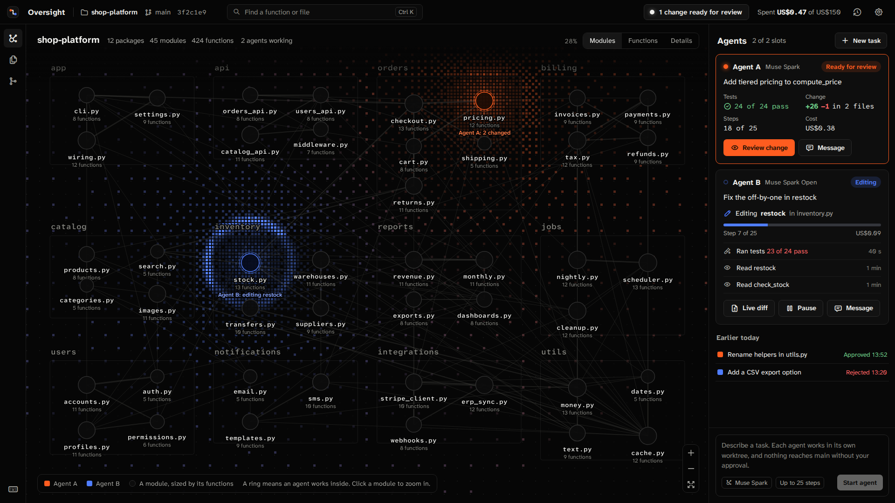

# Oversight

Human oversight for coding agents.

Oversight is a visual IDE for Python projects where you supervise coding agents while they work. The
repository is shown as a live graph of modules, classes, and functions parsed from the source. Agents
built on Meta's Muse Spark, through the Meta Model API, edit the code, each in its own git worktree.
The functions an agent reads or edits light up in its color, and clicking one opens its live diff.
When a function changes, the graph shows its impact cone: every function that calls it, directly or
through others. Nothing reaches main until you approve it.

**Status:** in development during the Meta Global AI Developer Hackathon, from 2026-10-26 to
2026-11-04.

## Built during the hackathon

- The hackathon runs from 2026-10-26 at 12:00 ET to 2026-11-04 at 21:00 ET (13:00 to
  23:00 ART). All code in this repository was written since the kickoff, and the git history shows
  it. The first commit came after the kickoff, and [DEVLOG.md](DEVLOG.md) records what was built
  each day.
- Before the kickoff there were planning notes and UI sketches, and no code. What the project takes
  from them is written again here, under `docs/`.
- No code comes from other projects. Dependencies keep their own licenses: MIT, Apache-2.0, BSD, or
  ISC, and SIL OFL 1.1 for fonts. GPL projects were read for ideas only.
- Agents inside the product use only Meta models: Muse Spark through the Meta Model API, and Muse
  Spark Open through partner inference.
- Merged on day 1: repository tooling and CI; contracts v1 and 1.1 with generated schemas and types;
  the demo repository; the SQLite event store and SSE; the graph core, impact cone and preset
  layout; the worktree runner, agent runtime and scripted fake model; the change manager; and API
  wiring with the spending brake. The UI includes the graph, agent cards, live diff, Approve and
  Reject, task entry, the review impact cone and the spend meter. The runtime also supports revision
  runs through `POST /changes/{id}/request-changes`, including the review UI.
- `make demo` builds and serves the frontend and API together; starting an agent uses API credits.
  `make demo-check` checks the API demo path three times from clean starts using two scripted fake
  agents, without API keys or credits: overlap, Request changes and a higher revision, merge,
  Stop/discard during work, a file edit on main, usage ticks and saving the editable new side
  (`PUT /files` with `agent_id`). Smoke tests, screenshot tooling and test resource caps are merged.
- Level 2 closed on Tue Oct 27. Close-run logs, validation results and spending records are
  not included in this repository.
- The static replay build currently plays a hand-written event log and labels it as a fixture. A
  real recorded run for the judges has not been bundled yet.

To bundle a finished real run, install gitleaks 8.30.1 and run `make record RUN=<id>` (or
`make record` for the latest run). This reads the SQLite log without model calls or credits and
writes `fixtures/events/recorded-demo.jsonl` with a `.provenance.json` sidecar. Keep both files
together: the static replay build verifies the exporter marker, SHA-256, run id, real model
profiles and every event against the contracts, and scans for secrets again before bundling.
Fake runs, unmarked fixtures, invalid events, secrets and absolute paths are refused. Without a
recording the build uses the hand-written fixture and labels it as such.

## Next

### Zoom levels

For a repository too large to read at once, the graph would switch between three levels as you zoom:

- **Modules:** each module is a circle sized by its function count, with one line per pair of
  modules, thicker with more calls.
- **Functions:** modules become frames and functions become dots, named only where an agent works or
  the impact cone reaches.
- **Details:** the labeled boxes of the current view, with every call.

Agents and the impact cone stay visible at every level, nothing moves when the level changes, and
labels keep their size on screen. Not built yet; it comes after the core features, if time allows.

*Design sketch, not built. Its structure comes from a sketch made before the kickoff, redrawn in
Oversight's look on 2026-10-26. It is a picture of the idea, not the product: its name and numbers
are placeholders.*

More candidates beyond the scope levels, in the order proposed, are in
[docs/additions.md](docs/additions.md). None is built yet.

## License

MIT. See [LICENSE](LICENSE).
