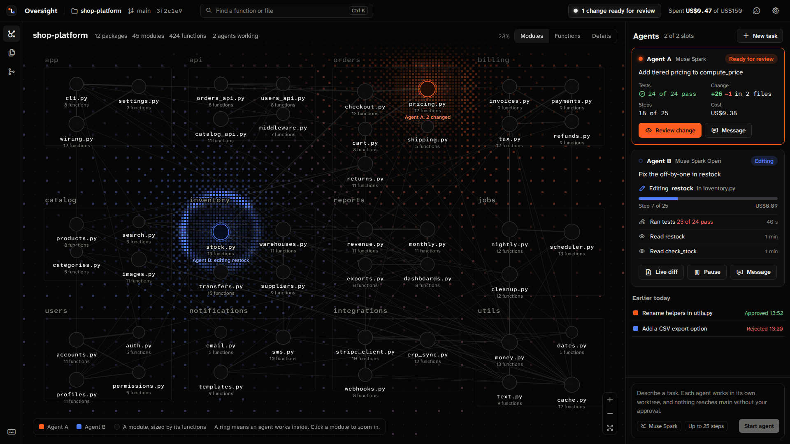

# Oversight

Agents write code faster than anyone can review it. Oversight is how you stop reading code without
losing control.

Oversight is where a person plans, watches and reviews the work of several coding agents built on
Meta's Muse Spark, with cost, evidence and the merge decision in one place. Today, in a small web
IDE for Python projects, the agents work on a live graph of your repository. Each agent has its own
git worktree. The functions an agent reads or edits light up in its color, and each change shows
its impact cone, the functions possibly affected. Nothing reaches main until you approve it.

Try [Would you approve it?](https://matidegli.github.io/oversight/): a real recorded run in your browser, no install, works at phone width; choose “Two-change practice”.

Video: (link added at submission)

The idea of running both versions of a change to find what tests miss is not new. Testora (ICSE
2026) checks behavior differences in pull requests against their intent. DiffTestGen (2026)
generates tests that expose them. Meta's just-in-time catching tests (FSE 2026) generate tests that
catch a bug before a change lands. CONTRA (2026) asks only the clarifying questions whose answers
change behavior, checked by running programs. Oversight brings these ideas to supervising agents
while they work. Product measurements come from Oversight's own bench; the build-process figures
below are labeled separately.

**Status:** in development during the Meta Global AI Developer Hackathon, from 2026-10-26 to
2026-11-04.

## What works today

- Chat opens first; Oversight is one click away and loads the live repository graph and impact cone
  of functions possibly affected on that first switch.
- On by default: agents work in their own git worktrees, with reads and edits lit on the graph.
- On by default: live diff and review with Approve, Reject and Request changes.
- On by default: four agent slots, configurable up to six (A–F), working in parallel.
- On by default: a spend meter and a brake that refuses new runs above 90% of the credit budget.
- The static replay build is on by default and plays the real two-agent run in
  `fixtures/events/recorded-demo.jsonl` without a backend. Its
  label comes from the recording's provenance sidecar: `Recorded run · Oct 27, 2026`.
- On by default: facts and a summary derived from events for each change (item 1).
- Built, off by default: an opt-in agent harness pack with syntax checks, bounded search and test feedback (item 3).
- On by default: checks that a new test fails before the change and passes after it (item 6).
- Built, off by default: opt-in cross-review and automatic Request changes (item 7).
- Built, off by default: opt-in behavior diff, comparing old and new functions on the same inputs, with graph count chips and sample popovers.
- Built, off by default: opt-in measured caller evidence in review and measured caller words on the review graph.
- On by default: live overlap on the graph and agent cards, including shared edits and earlier reads.
- Available by explicit selection: merge by rules, idle and queued follow-main, and person-triggered Revert in review. Every fresh run starts in Ask me; rules require isolation C, independent cross-review and all nine guards.
- In progress: a change card with three states.
- Built: desktop aggregate Usage, archived change totals and event-derived usage measurements; live period grouping, static aggregates and phone layout remain.
- In progress: server-computed plan zones, Edit and post-dispatch plan tracking; Queue/Reject/Keep, plan routes, dependency dispatch and the task queue are built.
- On by default: standing grant selection, listing and revocation; automatic use requires explicitly selected rules mode and current grant/evidence checks.
- On by default: a lead runtime that requests plans for the person's approval; it never starts coding agents or merges changes.
- Built, not yet released: Lead Chat renders highlight, exact changed-file, measured behavior
  and moment references from committed events. A click opens the graph or read-only diff;
  moments show live event facts and rewind only in replay, retaining Chat with an explicit Back.
  Synthetic browser fixtures cover these interactions; the public replay still uses the real
  Oct 27 recording. `show_view` is advertised and dispatched with the moved prompt version
  (DECISIONS, November 3). The separately authorized paid probe and prompt validation,
  a real recording and bundle replacement remain release gates.

Muse Spark through the Meta Model API writes the changes. In the bundled recorded run, agent B
wrote with Muse Spark Open through Baseten. Cross-review with Muse Spark Open is optional and off
by default (`OVERSIGHT_CROSS_REVIEW`), and absent from that recording. A change reaches main only
with the person's approval or by meeting rules they set. `make record-rules` generates a separate
fake-only activation fixture; `make rules-check` proves three clean starts without spending credits.

## How it was built

Oversight was built during the hackathon with a hand-run version of its own workflow: parallel
coding agents, each on its own branch and copy of the repository; a reviewer from a different
model provider on every change; and a coordinator merging only after the full checks pass.

These figures describe **our build process, not Oversight measurements**. This dated snapshot
is not the current main count: Oct 29, 2026,
22:38 ART, on main `d768d6d`.

- 187 fronts (one task each) run through the loop; latest acceptance at review round 0: 128, round 1: 40, round 2: 5; median 1 review round per front.
- 416 full verification runs over 380 review rounds: about 1.1 full suites per round.
- Writer slots: 3 per coordinator line, two lines; at most 6 concurrent writers.
- 13 collisions between two fronts found only at landing, after both were accepted.
- 243 merges to main and 1,126 commits on main since the kickoff.
- Tests are 59% of tracked Python and TypeScript source lines, excluding generated contracts, fixtures and the demo repository.

## Built during the hackathon

- The hackathon runs from 2026-10-26 at 12:00 ET to 2026-11-04 at 21:00 ET (13:00 to
  23:00 ART). All code in this repository was written since the kickoff, and the git history shows
  it. The first commit came after the kickoff, and [DEVLOG.md](DEVLOG.md) records what was built
  each day.
- Before the kickoff there were planning notes and UI sketches, and no code. What the project takes
  from them is written again here, under `docs/`.
- No code comes from other projects. Dependencies keep their own licenses: MIT, Apache-2.0, BSD, or
  ISC, and SIL OFL 1.1 for fonts. GPL projects were read for ideas only.
- Agents inside the product use only Meta models: Muse Spark through the Meta Model API, and Muse
  Spark Open through partner inference.

### Recording a real run

To bundle a finished real run, install gitleaks 8.30.1 and run `make record RUN=<id>` (or
`make record` for the latest run). This reads the SQLite log without model calls or credits and
writes `fixtures/events/recorded-demo.jsonl` with a `.provenance.json` sidecar. Keep both files
together: the static replay build verifies the exporter marker, SHA-256, run id, real model
profiles and every event against the contracts, and scans for secrets again before bundling.
Fake runs, unmarked fixtures, invalid events, secrets and absolute paths are refused. The public
static build requires the recording and its receipt; UI tests select their own fixtures explicitly.

## Next

- Per-agent live previews side by side, each agent's own app running from its worktree.
- Run Oversight on its own repository.
- After the hackathon: views composed from a closed set of typed primitives (a table, a
  before/after comparison, a list of references, a test timeline), with every value still
  resolved from a reference to the run's events. Components written by the model and run in a
  sandbox stay out of the Oversight and Chat views: they could show a value no event supports
  and cannot be held to DESIGN.md.
- Saved agent flows: after the lead, pick a repository flow with a target and expected checks, review or edit its filled task text, then start the agent.
- Hidden test sets: extend beyond the external hidden grading already present in `tools/eval`.
- A red agent to look for counterexamples to a proposed change.
- A specialist engine for checks that need a dedicated tool.
- Two independent attempts on one task: twice the generation cost; separate from the existing automatic revision round.
- Executable disagreement between the two models, resolved with an example.
- Canary changes: a product workflow beyond the seeded defects already in the task bench.
- Fork a run from a recorded step.
- Answer a review question from a phone.
- Text rules attached to areas of the repository.
- Tell the later agent about an overlap in its next tool result; each agent already has a worktree.
- Select tests from the graph inside the agent loop, starting in shadow mode.
- Per-test coverage, beyond the per-test outcomes already recorded.
- Mask older tool results on long runs; measure dollars and correctness before adoption.
- Generate inputs for behavior that the bounded probes did not reach.
- Run the bench on a real repository.
- Filesystem isolation for tests and probes (bubblewrap on Linux); today's isolation covers the
  network and the process tree only. No filesystem sandbox during the hackathon.
- After the hackathon, as a plan first: run the repository's git hooks as evidence, not inside
  commits: in the isolated runner on the proposal, shown on the card as passed or failed, with any
  formatter edits appearing in the diff. Agent commits keep hooks disabled.
- After the hackathon, as a plan first: repositories without Python open in Chat; Oversight shows
  the Files tree with presence instead of the graph. Agents, worktrees, diff, review, cross-review,
  merge and tests still work. Needs a per-repository test command with JUnit output and an approved
  sketch first.
- A bounded pre-freeze Tauri spike follows the maintainer's other feature conditionally.
  The [portable desktop core](desktop/README.md) is implemented; the Windows executable
  and native acceptance are deferred. It will wrap the advanced native backend and
  existing UI, with no WSL bridge or native picker. See the [future runbook](#future-tauri-shell-runbook).
- The minimal native Windows backend and validated own-repository COPY startup are implemented;
  native qualification remains pending (see below). Broader platform ports, macOS and
  native Windows isolation remain later work.
- After the hackathon: keys typed into a packaged app's Settings, write-only and kept by the
  local backend; needs the secrets rule changed, a contract change and a reviewed security plan.

### Scale and depth

Depth and scale are two axes. The built **Modules / Functions / Details** control (`bfe7a18`)
sets how much unfolds. Scale is the zoom: how it is drawn.

The map at rest and folder groups are built.
See [Scale and depth in DESIGN.md](DESIGN.md#scale-and-depth) for what is built and what remains a target.



*Earlier sketch, not the target. Its structure comes from a sketch made before the kickoff,
redrawn in Oversight's look on 2026-10-26. Its name and numbers are placeholders; it includes the
middle level now dropped.*

See [docs/additions.md](docs/additions.md) for the queue and candidates.

## License

MIT. See [LICENSE](LICENSE).

## Native Windows advisory checks

Startup/lifetime, native metadata/tree I/O, demo tools and validated public native Windows
own-repository COPY with guarded results are implemented. Native qualification remains pending.
The separate `windows advisory` workflow is unrequired; failures still fail its job.
Its logs distinguish injected tests, native tests and skipped proofs. Linux/WSL remains the
verified development path. Windows runs open mode with OPEN_NOTICE: no network isolation,
rules, Revert, behavior or measured evidence, and no memory cap (`memwatch` needs `/proc`).

Use non-elevated PowerShell, Python 3.12, Git, uv, pnpm, Node 24 and gitleaks 8.30.1 on PATH,
in a short, private, nonsynced local NTFS clone. Keep Defender enabled without exclusions.
For the staged smoke:

```powershell
git clone -c core.autocrlf=false <origin-url> "$HOME\src\oversight"
cd "$HOME\src\oversight"
uv sync --frozen
pnpm -C frontend install --frozen-lockfile
pnpm -C frontend build
uv run --frozen python tools/smoke.py
uv run --frozen pytest -o timeout_method=thread backend/tests/workspace/test_platform_windows.py -rs -s
uv run --frozen pytest -o timeout_method=thread tools/tests/test_demo_check_nt.py -rs -s
```

Retain Windows/CPython/Git/tool versions, event-loop type, console exit codes, logs and all skip
reasons. `OVERSIGHT_NT_EVIDENCE_DIR` optionally selects the parent for retained tool logs. A
missing console or skipped native test is not acceptance. The candidate SIGBREAK exit status
`0xC000013A` must be confirmed by the console test; timeout or forced cleanup cannot pass its
graceful verdict. There is no added Uvicorn handler (pinned 0.54.0).

Use the live server for manual UI/health/graph/SSE proof:

```powershell
$env:META_API_KEY=""; $env:BASETEN_API_KEY=""; $env:OVERSIGHT_CROSS_REVIEW="false"
$env:OVERSIGHT_WORKSPACE_SOURCE=""; $env:OVERSIGHT_AGENT_MODEL="fake"
$env:OVERSIGHT_FAKE_SCRIPT="fixtures/fake-model/document-apply-coupon.json"
uv run --frozen python -m oversight serve
# Ctrl+C must log Application shutdown complete, then:
uv run --frozen python tools/demo_check_nt.py --probe-lock .runtime
# Stop serve before running the disposable checks:
uv run --frozen python tools/demo_check_nt.py
uv run --frozen python tools/demo_check_nt.py --hard-kill-check
$env:OVERSIGHT_NT_FULL_DEMO="1"
uv run --frozen pytest -o timeout_method=thread tools/tests/test_demo_check_nt.py -rs -s
```

Verify OPEN_NOTICE and malicious-static-path 404s, then the docstring task in `shop/pricing.py`:
read/edit/tests/proposal/Approve must produce merged + graph.delta. Retain initial/merge commits,
the `.git` pointer, empty worktrees, raw bytes/hash and
`git -C .runtime/workspace ls-files --eol shop/pricing.py` showing `i/lf w/lf`. Restart over
read-only objects. On a junction pointing only at a disposable canary, files must refuse access,
tree/graph omit it, restart unlink it and outside hashes remain unchanged. Check replay API/SSE
separately with `uv run --frozen python -m oversight replay fixtures/events/handwritten-level1.jsonl
--allow-fake-provider`; UI proof uses live serve. No model credits are used.

No Windows make/bash/reload or native browser suite is supplied. Validated native Windows
own-repository paths are enabled; POSIX paths and source Git configs with includes or
`core.excludesFile` paths that are absolute, UNC, drive-prefixed or start with `~` or `%(prefix)`
are refused. Run the same driver on the maintainer's Windows machine and windows-latest:

```powershell
uv run --frozen python tools/demo_check_nt.py --own-fixtures
uv run --frozen pytest -o timeout_method=thread backend/tests/workspace/test_source_nt_windows.py -rs -s
```

This adds three disposable own-source runs to the three demo runs. It retains source hashes,
copy-specific failed/repaired and combined-suite evidence, pytest-asyncio autoload, restart refusal, binary full-index
export, explicit apply/check to a separate disposable target, byte parity and exact-hash discard.
Neither Windows machine has qualified this path yet; Linux injections/skips are not acceptance.
Use [the chosen-repository fake template](docs/workspace-source.md#chosen-repository-template)
for a trusted repository. That workflow never automatically applies or discards its changes.
Set `OVERSIGHT_TEST_TIMEOUT_S` before startup (default 60, no policy maximum). The console says
`Test limit: {T} s. Agent time limit: {W} s per round. These settings stay fixed for this run.`
Demo/Boltons retain 60 seconds and log
`OVERSIGHT_TEST_TIMEOUT_S applies only to your own repositories; this run keeps 60 s.`
when a different value was configured.
Before making Windows required, measure complete installs/build/tests/six runs, use
`ceil(1.5 × slowest green duration)` for the timeout and remove PR path filters so even a
documentation-only PR produces a successful check. The advisory bound is 75 minutes, reserving the desktop cold-build margin;
the current desktop lane checks only the portable core. Native duration/size remain unmeasured.


### Future Tauri shell runbook

**Prospective: no desktop executable is delivered by this slice.** The portable core and
standalone `make check-desktop` are available; `desktop/shell/`, release build and native
lifecycle/UI proof remain pending. The spike follows the maintainer's other pre-freeze feature;
unfinished executable work defers at November 3, 17:00 ART, before the 20:00 ART freeze.
The advanced native backend and browser route above remain available.

For the future shell, add Rust/cargo **1.98**, rustfmt, MSVC C++ build tools, the Windows SDK
and WebView2 to the native prerequisites above. Use a non-elevated PowerShell in the validated
native clone, without WSL path translation. Prepare the synced environment and built UI:

```powershell
uv sync --frozen
pnpm -C frontend install --frozen-lockfile
pnpm -C frontend build
# Explicit online preparation, also usable now for the portable core:
cargo fetch --locked --manifest-path desktop/Cargo.toml
$env:CARGO_NET_OFFLINE = 'true'
cargo --offline --locked fmt --manifest-path desktop/Cargo.toml --all -- --check
cargo --offline test --locked --manifest-path desktop/Cargo.toml -p oversight-desktop-core
# FUTURE ONLY: requires the deferred shell crate and its reconciled lockfile:
cargo --offline build --locked --release --manifest-path desktop/Cargo.toml -p oversight-desktop
.\desktop\target\release\oversight-desktop.exe --smoke
# While the first instance is open, repeat to prove focus without a second backend:
.\desktop\target\release\oversight-desktop.exe --smoke
```

Bundling stays inactive; Python and WebView2 are prerequisites, not bundled payloads.
The future window owns `.venv\Scripts\python.exe -m oversight serve` in the clone root,
without reload. Host/port/Vite overrides are `127.0.0.1`, `8710` and empty, taking precedence
over `.env`. Only verified child/Job listener ownership plus bounded live `/health` admits
`http://127.0.0.1:8710/`. Keep same-origin HTTP/SSE and existing authority checks.
`--smoke` forces fake A/B scripts, blank provider keys, cross-review off and demo source.
Starting real agents outside smoke retains the backend's existing credit rules.

Accept only one window/backend. Verify graph/WebGL, local Monaco/fonts, focus, SSE and
OPEN_NOTICE, then graceful close and immediate restart, three clean starts. Preserve the
existing native capability restrictions: no Windows isolation, rules, Revert, behavior or
measured evidence. No native folder picker: the shell accepts demo or the exact pinned
profile only; native pinned-profile qualification is still pending.

Exercise busy 8710 (refuse without attaching/killing its owner), missing dist, failed startup,
close during startup, shell crash and spaced/Unicode clone roots. Verify nested Jobs, shared
console group-only signaling, at most five seconds before owned Job termination, handle reap
and no owned descendants/listener. Forced cleanup never passes graceful acceptance. Retain
sanitized logs, versions, actual added duration and exe size; never print `.env`, credentials
or environment dumps. Both native lifecycle/UI acceptance and independent review are required
before executable delivery; advisory CI alone cannot supply headed acceptance. Rollback removes
desktop code, its standalone target and Windows workflow additions while preserving the browser
and advanced native backend.

### Reviewed preview qualification

Private reviewed-preview wiring joins verified preparation, an authenticated Linux allowlisted root,
read-only dependencies, a pidfd namespace connector and a supervisor-owned publication/HTTP gateway.
Controlled fixtures exercise this path; the reviewed self application remains refused until its
explicit no-key entry, distinct ports, source re-pin and final story/browser acceptance are complete.
Default readiness is 30 seconds and owner-loss grace is 600 seconds, with immediate authenticated
Close. All limits are person-owned. Without delegated cgroups, per-process limits only; aggregate
usage is not enforced. Tests and the shop retain their filesystem residual; native Windows remains
trusted same-user execution without a no-key/no-paid-call guarantee. See [isolation](docs/isolation.md)
for exact limits, qualification and reading sanitized logs from Windows/WSL. Desktop log viewing is
not delivered; the existing HTML startup disclosure remains the bounded fallback.
